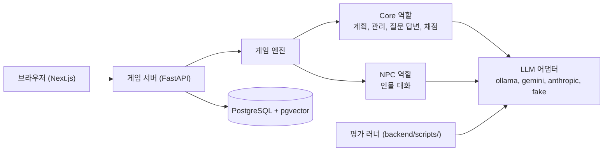

# REMAKE DAY

AI가 연기하는 등장인물들과 대화하며 세계가 멸망하는 이유를 찾아내는 추리 게임입니다. AI가 다음 날 세계를 바꾸는 규칙을 제안하면, 플레이어는 받아들이거나 거절하거나 직접 규칙을 씁니다. 원티드 AI Championship 2026 출품작이며, 본선에는 오르지 못했습니다.

포트폴리오 소개 페이지: https://remakeday.jangminseok.com <br>
게임 주소: https://remakeday.com <br>
연구 사이트: https://blog.remakeday.com <br>
상태: 대회 출품 뒤 개발을 마쳤습니다.

> 이 저장소는 5인 팀 프로젝트의 최종 코드를 개인 계정으로 옮긴 사본입니다. 원본 저장소는 [remakeday/com.remakeday](https://github.com/remakeday/com.remakeday)이고, 팀의 커밋 기록은 원본에 있습니다. 사본에는 원본의 마지막 작업 브랜치에 이미지를 WebP로 바꾸고 다음 화면 이미지를 미리 불러오도록 한 마무리 작업을 더했습니다.

## 한눈에 보기

| 항목 | 내용 |
|---|---|
| 기간 | 2026-09-01 ~ 2026-10-07 |
| 인원과 역할 | 5인 팀에서 AI 평가(AI Evaluation Engineer)를 맡았습니다. 평가 설계, 평가 러너, LLM 어댑터, 응답 지연과 GPU 메모리 측정이 제 일이었습니다. |
| 상태 | 대회 종료 |
| 주요 기술 | Python, FastAPI, PostgreSQL, pgvector, Ollama Gemma 4, Kanana 1.5, Claude API, Gemini 임베딩, Next.js, React, TypeScript, Jekyll |

## 주요 기능

- **되풀이되는 하루 속 인물과 대화**: 오늘이 지나면 세계가 멸망합니다. 플레이어는 다섯 번의 하루 안에 그 이유를 알아내야 합니다. 인물마다 AI가 성격과 기억을 가지고 대답하고, 플레이어는 대화로 단서를 모읍니다.
- **밤마다 추리를 적어 내고 점수 받기**: 하루가 끝나면 모은 단서로 추리를 적어 냅니다. AI 채점관이 그 추리를 숨겨진 진실과 한 문장씩 맞춰 보고 점수를 매깁니다.
- **AI에게 묻고 근거와 함께 답 받기**: AI는 플레이어가 모은 기록 안에서만 답하고, 답의 근거가 된 기록을 함께 보여 줍니다.
- **AI의 제안을 받거나 거절하기**: AI는 다음 날 세계에 걸 규칙을 제안합니다. 대가가 따르는 제안도 섞여 있어, 사람이 AI 제안을 어떻게 받아들이는지가 이 선택에 그대로 남습니다.
- **연구자용 판 기록 화면**: 판마다 시간순 사건, 적용된 규칙, 채점 근거를 한 화면에서 확인합니다(`frontend/app/inspector/`). 제가 만든 화면입니다.

## 구조



- **규칙은 코드가, 말과 판단은 AI가**: 세계가 굴러가는 규칙은 코드로 정해져 있고, AI는 인물의 말과 채점 같은 판단만 맡습니다. AI의 답은 형식 검사를 통과해야 쓰입니다. 이 구조는 팀원이 설계했습니다.
- **설정값 두 개로 AI 모델을 바꿔 끼웁니다**: 게임 엔진은 AI에게 묻기만 하고, 어느 회사의 모델인지는 모릅니다. 설정값 두 개만 바꾸면 GPU 한 장짜리 로컬 모델과 외부 API 사이를 오갈 수 있습니다. 이 어댑터는 제가 맡았습니다.
- **평가는 게임과 같은 프롬프트로**: 평가 러너는 게임 서버 없이 게임과 같은 프롬프트를 후보 모델에 직접 보냅니다. 그래서 모든 후보를 같은 시험으로 측정할 수 있습니다. 결과는 [`docs/metrics.yml`](docs/metrics.yml)에 날짜와 조건을 붙여 쌓았습니다.

| 경로 | 내용 |
|---|---|
| `backend/apps/engine/` | 게임 엔진, API, LLM 어댑터입니다. |
| `backend/apps/scenarios/` | 시나리오, 인물, 금칙어 같은 이야기 데이터입니다. 엔진은 시나리오 내용을 모릅니다. |
| `backend/scripts/` | 모델 선정, 채점 보정, 규칙 추천 비교 같은 평가 러너입니다. |
| `frontend/` | 게임 화면과 연구자용 판 기록 화면입니다. |
| `docs/` | 모델 평가 정본(`model_evaluation.md`), 실측 기록(`metrics.yml`), 설계 문서, 팀 역할 문서입니다. |
| `output/npc-dialogue-2026-09-15/` | 인물 대화 검사의 실행 결과와 평가 보고서입니다. |

## 제가 맡은 일

- 평가 설계와 합격 기준 정하기
- 후보 모델을 같은 시험으로 비교하는 평가 러너 ([`backend/scripts/run_core_selection.py`](backend/scripts/run_core_selection.py), [`run_scoring_calibration.py`](backend/scripts/run_scoring_calibration.py), [`run_rule_alternatives_eval.py`](backend/scripts/run_rule_alternatives_eval.py))
- Core 모델과 NPC 모델 선정 실험
- 실측 결과를 쌓는 기록 파일 [`docs/metrics.yml`](docs/metrics.yml)
- LLM 어댑터 4종 ollama, gemini, fake, anthropic ([`backend/apps/engine/adapter/outbound/llm/`](backend/apps/engine/adapter/outbound/llm/))
- 응답 지연과 GPU 메모리 같은 배포 지표 측정
- 판 기록을 보여 주는 Inspector 화면
- 연구 사이트의 실험 설계와 사람 판 관찰 집계

팀원이 맡은 일은 전체 아키텍처와 API 계약, AI 역할별 프롬프트, AI 답을 검사하는 하네스, 채점 코드를 포함한 게임 엔진과 데이터베이스와 게임 화면, 품질 검사와 배포 검증, 시나리오와 인물과 그림과 사운드입니다.

팀원 전원이 온프레미스 서버 한 대에 SSH로 접속해 코드를 고치고 바로 테스트했습니다. 그래서 원본 저장소의 커밋은 서버 계정 하나로 남아 있고, 개인 기여는 팀 역할 문서([`docs/teamprofile.md`](docs/teamprofile.md))를 기준으로 나눕니다.

## AI와 함께 만든 방식

- 저장소 루트와 `backend/`, `frontend/`에 AI 코딩 도구가 따를 규칙 문서(`CLAUDE.md`, `AGENTS.md`)를 두었습니다.
- 작업의 중요도에 따라 검토 강도를 세 단계로 나누고, 외부 API 어댑터와 채점 코드처럼 비용과 점수에 닿는 작업은 가장 무거운 검토를 거치게 했습니다.
- 큰 작업은 설계 문서와 계획 문서(`docs/superpowers/`)를 먼저 쓴 뒤 구현했습니다.
- 규칙 추천 순위를 확인하는 시험 문장 30개는 AI 에이전트가 초안을 썼습니다. 그대로 믿지 않고 팀원이 검수한 22문장으로 다시 측정해, 결과가 유지되는지 확인했습니다.

## 검증

| 영역 | 무엇으로 확인하나 | 결과 (2026-11-18, 이 사본에서 실행) |
|---|---|---|
| 백엔드 | pytest (테스트용 PostgreSQL에 연결) | 1,059개 통과 |
| 백엔드 구조 | import-linter 계약 | 4종 모두 지킴 |
| 화면 | `next build` (타입 검사 포함) | 통과 |
| 화면 흐름 | Playwright로 실제 화면을 끝까지 진행하는 시나리오 테스트 | `frontend/tests/` 13개 (로컬 실행용) |

평가로 확인한 결과입니다.

- **채점 번호 오류 35%에서 0.6%로**: 채점관이 근거로 2번 후보를 인용하고도 번호는 1로 적는 일이 있었습니다. 저장된 채점 249건을 모두 살펴 인용이 있는 181건 중 38건이 인용과 다른 번호였고, 38건 모두 하나 작은 번호라는 것을 찾았습니다. 근거 문장을 번호보다 먼저 옮겨 적게 바꾼 뒤 같은 249건을 다시 채점하자 번호 오류가 162건 중 56건(35%)에서 163건 중 1건(0.6%)으로 줄었습니다. 저는 전수 조사와 재채점 비교를 맡았고, 채점 코드 수정은 팀원이 했습니다.
- **두 모델을 16GB GPU 한 장에**: 모델 파일 크기로 추정하지 않고 실제로 올려서 측정했습니다. 채택한 Core 모델과 Kanana NPC 모델은 합계 12.42 GiB였고, 번갈아 요청을 보낸 구간에서 밀려난 모델이 없었습니다. 여러 사람이 동시에 접속하는 부하는 아직 측정 전입니다.
- **규칙 추천 첫 순위 정확도**: 30문장 비교에서 단순 단어 비교는 0.300, 임베딩 비교는 0.967이었습니다.
- **외부 API 한 판 비용**: 엔진을 바꾸지 않고 Anthropic 어댑터로 옮긴 뒤, 기록된 호출 92회를 실제 토큰 수로 세어 0.461달러였습니다. 기록에서 빠진 인물 대화까지 넣으면 약 0.9~1.2달러(추정)입니다.

측정 과정과 원자료는 [`docs/model_evaluation.md`](docs/model_evaluation.md)에 있습니다.

## 시작하기

필요한 것: Docker(Compose 포함), Python 3.13, Node.js. AI 모델 없이도 `fake` 어댑터로 게임 흐름을 확인할 수 있습니다. 실제 모델을 쓰려면 Ollama나 외부 API 키가 필요합니다.

```bash
# 루트 .env 에 POSTGRES_PASSWORD 를 넣고 DB 를 띄운다 (127.0.0.1:5435)
docker compose up -d

# 백엔드 (backend/ 에서). .env 에 DATABASE_URL 과 SESSION_SECRET 을 넣는다
pip install -r requirements.txt
alembic upgrade head
uvicorn main:app --port 8500

# 테스트 (DB 이름은 _test 로 끝나야 한다)
TEST_DATABASE_URL=postgresql+psycopg://pigfarm:<비밀번호>@localhost:5435/pigfarm_test pytest
lint-imports

# 화면 (frontend/ 에서)
npm ci
npm run dev        # http://localhost:3500/play
```
